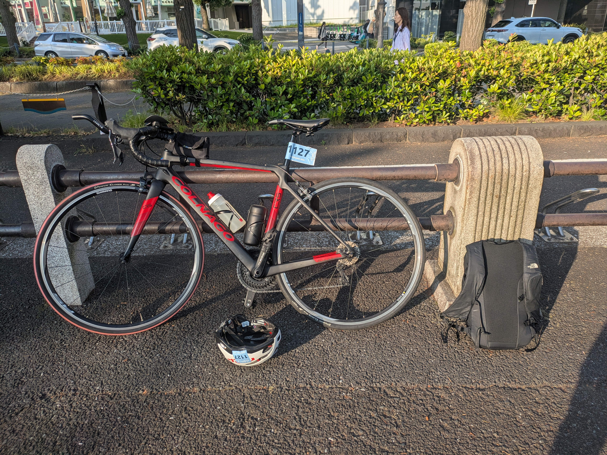
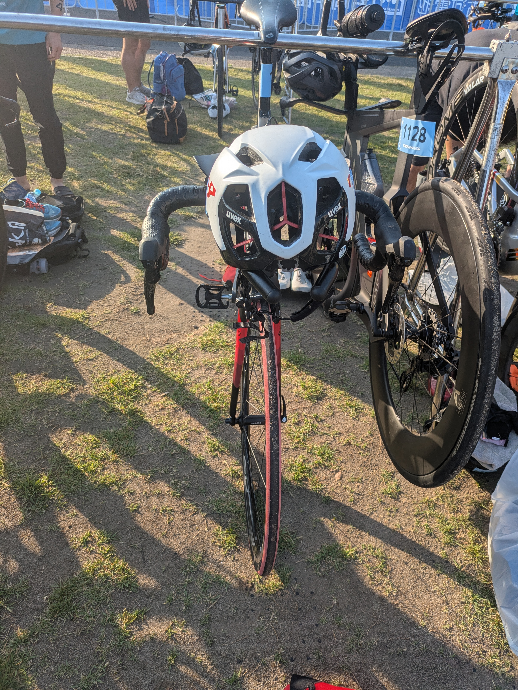

前回の[WTCS横浜2026 完走記](2026-05-17-yokohama-wts-finish.html)の最後に、こんな伏線を残していました。

> DHバーを始めてまともに使ったが完全にチート。でも、説明通り6N·m締めたのに段差で揺れるとバーの角度がずれる…（恐怖）。対策に **ファイバーグリップ** を買った。次回ライドで効果検証予定。

その回収編です。**規定値まで締めているのに滑る** ── このちょっと不安な問題を、あるアイテムで解決しました。同じくクリップオンDHバーがずれて困っている初心者の方の参考になればと思います。

---

## 症状：規定トルクで締めても滑る

使っているのはクリップオンタイプのDHバー、**PROFILE DESIGN LEGACY II**。普通のドロップハンドル（ベースバー）にクランプで挟んで固定します。

説明書どおり **6N·m** で締めているのに、舗装の段差や荒れた路面で衝撃が入ると、エクステンション（肘から先を乗せて握る棒）の角度がジワッとずれる。エアロポジションは体重をかなり前に預けるので、走行中に「カクッ」と動くと正直こわい。

トルクレンチで規定値まで締めているのに、なぜ滑るのか。締めすぎは禁物（特にカーボンは割れる）。かといって緩いと滑る。**トルク管理だけでは止めきれない滑り** が、ここにはありました。

---

## 解決：ファイバーグリップ（摩擦ペースト）を塗る

やったことはシンプルです。

ファイバーグリップを **薄く**塗って､**規定トルク（6N·m）まで締め直しただけ**

規定トルクまで締めなくても､かなり堅牢な状態になりました｡ローラー台で試したところ,感度良好｡
体重をかけても､びくともしません(本来がっつり体重をかけて乗るものではないけど､念のため)
これで､安心して､エアロポジションをとることができます｡

注意点を2つ。

- ざらざらした成分入りなので、位置を何度も付け直すと接触面に薄い擦り傷が残ることがある**（見た目だけの話で、強度には影響しません）。
- ペーストは **規定トルクの“代わり”ではなく“補助”**。**正規トルク＋ペースト** の合わせ技が正解です。

---

## 補足：カーボン同士でなくても効く

ファイバーグリップは俗に「カーボングリス」「カーボンペースト」と呼ばれ、日本語の通販ページでも「カーボンパーツの滑り止め」と説明されがちです。実際、メーカーFINISH LINEの英語の公式説明も、主眼は **クランプされたカーボン繊維面の滑り防止** に置かれています｡

私の場合DHバーもハンドルバーもアルミなので、接合面は **アルミ × アルミ** です。それでもファイバーグリップはしっかり機能しました。Amazonレビューでも同じ使い方をしている方を見かけたので､まぁ大丈夫だと思います(もちろん､最終的には自己責任で｡不安な方はアルミも使える､と明記されているこちらをオススメします｡ちょっと高いけど)

---

## 今後の検証：輪行で角度を変えるとき、塗り直しは必要か？

ひとつ未解決の疑問が残っています。**輪行**（電車などで運ぶために自転車を分解・収納すること）のときは、DHバーのクランプを緩めて角度を畳んだり戻したりします。このとき、**そのたびにファイバーグリップを塗り直す必要があるのか？**

現時点の仮説はこうです。

- グリットを **拭き取らない限り接触面に残る** ので、角度を少し変えて締め直す程度なら、**毎回の塗り直しは不要** かもしれない。
- ただし、付け直しを繰り返すと粒子が広がって **効きが落ちる** 可能性、アルミ面に **擦り傷** が増える可能性がある。
- → 「1回塗れば輪行を繰り返しても持つのか」「都度塗り直しが要るのか」は、実際に輪行を挟んで走って確かめる予定。結果はこの記事に追記します。

---

## まとめ

- DHバーが規定トルクでも滑るのは珍しくない。**摩擦ペースト** で解決できる。
- 滑り止めの正体は **研磨粒子の摩擦**。カーボン用だが、**アルミ × アルミでも有効**。
- 輪行での塗り直しの要否は **今後の検証課題**。

クリップオンDHバーは安価にエアロポジションを手に入れられる神アイテムですが、固定の信頼性は命に関わる部分。正しい方法でガッチリ留めて、安心して前傾していきましょう。

---

### 今回使ったもの

- DHバー本体：[PROFILE DESIGN LEGACY II](https://www.amazon.co.jp/dp/B0185OKVRY?tag=japason04-22)（鍛造6061-T6アルミ／クランプ31.8mm）
- 滑り止めペースト：[FINISH LINE ファイバーグリップ 50g](https://www.amazon.co.jp/dp/B0012RIEM6?tag=japason04-22)

<!-- ★動画：第1号「DHバーずれ対処」動画が出来たらここに <iframe> 埋め込み -->
<!-- DRAFT: build_blog_manifest.py での .html 生成 と git push は手動。プレビュー確認後に公開すること -->
